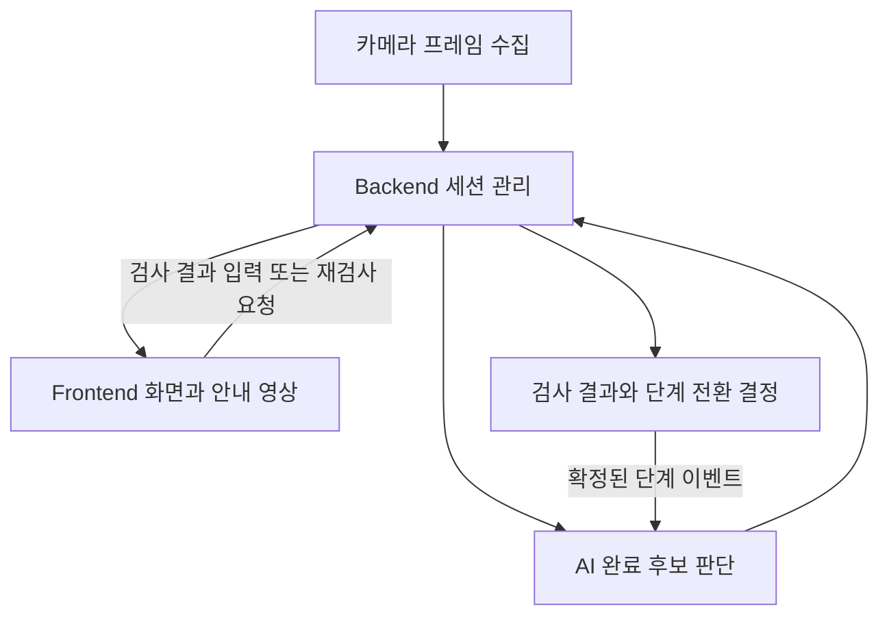

# FollowAlong — Backend / Frontend 연동 명세

기준일: 2026년 11월 4일

> **현재 구현된 AI API와, Backend → Frontend로 전달할 통합 JSON 제안은 다르다.** 아래 AI API는 V50 코드 기준이며, Frontend용 통합 JSON·Backend 공개 API·상태 저장·권한 검사는 앞으로 Backend에서 구현하고 팀이 합의할 계약이다. 이 문서는 해당 기능이 이미 연결됐다는 의미가 아니다.

## 1. 기본 방향

Frontend는 AI 모델·checkpoint·특징 벡터를 직접 처리하지 않는다.

> **Backend가 사용자 작업 세션을 관리하고, AI 결과와 현재 작업 상태를 정리한 Session State JSON을 Frontend에 전달한다.**

카메라 사진과 목표 단계는 Backend를 통해 AI 서비스에 전달한다. AI 서비스는 HTTP 요청에 JSON으로 응답하며, Backend는 그 결과를 상태에 반영한다.

Frontend가 Python AI 서버를 직접 호출하거나, AI 점수만 보고 단계 번호를 증가시키지 않는다.



사진이 어디서 추출되는지(브라우저·모바일·Backend)는 연결 환경에 맞게 정하되, 동일한 카메라 프레임과 시간 기준을 사용한다.

## 2. 전체 사용자 흐름

1. 사용자가 튜토리얼을 시작한다.
2. Backend가 세션과 최초 목표 단계를 설정한다.
3. 사진을 0.5초 간격으로 AI 서비스에 전달한다.
4. AI가 최근 5장의 특징으로 현재 목표 단계의 완료 후보를 판단한다.
5. 3회 연속 확인되면 완료 후보를 고정하고 검사 대기 상태가 된다.
6. 조립 상태를 검사한다. **현재는 외부·수동 검사이며, 일반 자동 검증 모델은 추가 개발 대상이다.**
7. 정상은 서버의 단계 전환 승인 대기, 오조립은 수정 안내, 확인 어려움은 구도 정리 안내로 처리한다.
8. 수정·구도 정리 후 명시적인 재검사 요청으로 새 검사를 시작한다.
9. Backend가 다음 단계 또는 종료를 확정하고 AI·Frontend를 동기화한다.

완료 후보는 정상 조립 확인과 다르다. 단계 변경의 최종 소유자는 Backend다.

## 3. 식별자와 시간 기준

| 필드 | 의미 | 사용 원칙 |
|---|---|---|
| `session_id` | 한 사용자 작업 세션 | 사용자별 상태 분리 |
| `tutorial_id` | 어떤 튜토리얼인지 | Backend가 관리하는 추가 정보 |
| `stage_id` | 현재 완성해야 하는 목표 단계 | 현재 레고 모델은 1~5, 종료 시 null |
| `stage_version` | 단계 상태 버전 | 단계 변경마다 1 증가 |
| `attempt_id` | 같은 단계의 검사 시도 번호 | 재검사마다 1 증가, 새 단계는 1 |
| `frame_id` | 사진 번호 | 세션 전체에서 계속 증가 |
| `captured_at_ms` | 카메라 기준 실제 촬영 시각(ms) | 수신 시각으로 대체하지 않음 |
| `candidate_event_id` | 완료 후보 식별자 | 검사 결과를 어느 후보에 적용할지 구분 |
| `request_id` | 제어 요청 식별자 | 같은 요청 재전송에 동일 ID 사용 |
| `event_id` | 재생 등 화면 동작 식별자 | 동일 이벤트 중복 실행 방지 |
| `state_revision` | Backend 통합 상태 갱신 번호 | 제안 필드, 오래된 화면 갱신 방지 |

`tutorial_id`, `state_revision`은 현재 AI API 필드가 아니라 Backend 통합 계약에 추가하는 값이다.

`stage_version`과 `attempt_id`는 별개다. 예를 들어 Stage3에서 잘못 조립한 뒤 재검사해도 단계는 Stage3 그대로이고, 단계 버전도 유지하며 attempt만 1→2로 바뀐다.

## 4. 목표 단계 정보 전달

현재 합의한 방식은 다음과 같다.

- 세션 시작 시 최초 목표 단계 1회 설정.
- 단계 변경이 확정됐을 때 새 목표 단계 이벤트 1회 전달.
- 사진은 단계 변경 여부와 관계없이 0.5초마다 계속 공급 가능.

3초마다 단계 정보를 계속 다시 보내는 방식이 아니다.

`stage_id`는 사진에서 눈에 보이는 조립 수준을 뜻하는 것이 아니라 **현재 사용자가 수행해야 하는 단계**다. 조원의 단계 인식 모델이 있어도 그 출력을 곧바로 다음 단계 진행 승인으로 쓰지 않는다.

## 5. AI에 보내는 프레임 요청 — 현재 구현

```http
POST /sessions/demo001/frames
Content-Type: application/json
```

```json
{
  "frame_id": 157,
  "captured_at_ms": 78500,
  "stage_version": 3,
  "attempt_id": 1,
  "image_base64": "<JPEG 또는 PNG를 base64로 인코딩한 문자열>"
}
```

- 세션에 현재 stage가 저장되므로 프레임마다 stage ID를 넣지 않는다.
- 현재 입력은 JSON body 8MiB, 이미지 12MP까지다.
- 현재 프레임 간격 검사는 500ms 기준 허용 오차 75ms다.
- 간격 누락·이탈 시 이력을 초기화하므로 네트워크 지연과 무관한 실제 촬영 시각을 전달한다.
- 사진을 오래 쌓아 뒤늦게 보내는 대기열은 실제 통합에서 점검해야 한다. 단순히 오래된 프레임을 대량 재생하는 것을 실시간으로 취급하지 않는다.

## 6. 완료 후보 응답 — 현재 구현

현재 실제 AI 응답에서 핵심 필드를 추린 예시다.

```json
{
  "session_id": "demo001",
  "stage_id": 3,
  "stage_version": 3,
  "attempt_id": 1,
  "frame_id": 157,
  "captured_at_ms": 78500,
  "model_mode": "real_v50",
  "completion_score": 0.999,
  "consecutive_positive": 3,
  "confirmation_required": 3,
  "history_frames": 5,
  "history_reset": false,
  "candidate_event_id": "demo001:3:157",
  "status": "awaiting_review",
  "workflow_phase": "awaiting_review",
  "requires_review": true,
  "auto_advance": false,
  "assembly_error_checked": false
}
```

의미는 ‘Stage3 완료 후보가 잡혔으므로 추가 검사 필요’다. `completion_score=0.999`라도 정상 조립을 확정한 것이 아니다.

이후 검사 대기 중 새 사진의 `completion_score`는 null일 수 있다. 이미 저장한 후보 점수·후보 ID를 지우지 않는다. Backend는 저장된 후보 또는 응답의 `candidate_score`를 사용해 화면 정보를 유지한다.

## 7. 완료 점수와 진행률 구분

`completion_score`는 모델의 완료 후보 점수다.

> **0.95는 실제 조립 진행률 95%도, 검증된 조립 정확도 95%도 아니다.**

일반 사용자 화면에는 ‘조립 중’, ‘완료 확인 중’ 등 상태를 우선 표시한다. 현재 점수로 0~100% 조립 진행률 막대를 만들지 않는다.

현재 판단 정책은 최근 5프레임, 완료 점수 0.5 이상 3회 연속이다. Stage5는 각 양성 판단에 탑승 점수 0.5 이상을 추가 요구한다.

Stage5 탑승 점수도 일반 오조립 확률이 아니다. 별도 일반 조립 검증 결과처럼 표시하지 않는다.

## 8. 작업 상태와 화면 처리

통합 JSON의 `workflow_phase`는 작업 상태를 나타낸다. 기존 AI 상태명을 유지하되 Backend가 원본 응답을 정규화한다.

| `workflow_phase` | 의미 | Frontend 기본 표시 | 기본 사용자 동작 |
|---|---|---|---|
| `active` | 사진 수집·완료 후보 판단 중 | 조립 중 / 사진 준비 중 | 대기 |
| `awaiting_review` | 완료 후보 고정, 검사 결과 대기 | 자동 검사 실행 중 또는 수동 확인 필요 | 현재 검사 방식에 따라 결정 |
| `awaiting_stage_event` | 정상 결과 수신, 서버 단계 확정 대기 | 정상 확인됨, 다음 단계 준비 중 | 서버가 승인한 동작만 수행 |
| `correction_wait` | 오조립 결과 수신 | 조립 상태를 확인·수정해 주세요 | 수정 후 다시 확인 |
| `needs_clear_view` | 확인 불가능 결과 수신 | 손을 치우고 지정 위치에 놓아 주세요 | 구도 정리 후 다시 확인 |
| `finished` | 서버가 마지막 단계 종료 확정 | 튜토리얼 완료 | 종료 |

`warming_up`, `progressing`, `recheck_started`, `stage_synchronized`는 현재 API의 응답 상태이며 별도의 영구 phase와 구분한다. 예를 들어 `warming_up`은 phase가 active인 동안의 완료 모듈 상태다.

통신 오류는 조립 오류가 아니다. 통신 끊김·HTTP 오류 시 단계와 검사 결과를 유지하고 연결 문제를 표시한다.

## 9. capability와 available의 구분

Frontend용 제안 계약에서는 둘을 분리한다.

| 필드 | 의미 |
|---|---|
| `capabilities.assembly_verifier` | 자동 일반 조립 검증 모델이 연결돼 있는가 |
| `verification.available` | 현재 단계·시도의 검사 결과가 존재하는가 |
| `verification.source` | 결과 출처가 manual인지 ai인지 |
| `verification.status` | 아직 시작 전·수동 대기·실행 중·완료·실패 중 어느 상태인지 |

자동 모델이 없어도 사람이 검사 결과를 넣으면 `verification.available=true`, `source=manual`이 될 수 있다. 반대로 모델이 연결돼 있어도 아직 검사를 하지 않았다면 available은 false다.

**현재 `capabilities.assembly_verifier=false`가 맞다.** 이때 완료 후보가 나왔다고 자동 검사 로딩을 무한히 보여주지 않고, 현재 단계에서는 수동 확인이 필요함을 표시한다.

현재 AI의 `error_verifier_available`·`assembly_error_checked` 등의 원본 필드와 위 통합 필드는 동일 구조가 아니다. V50은 일반 자동 오류 검사를 수행하지 않으므로 `assembly_error_checked=false`를 반환한다. Backend는 수동 결과와 AI 수행 여부를 별도로 기록한다.

## 10. 검사 결과 verification

최종적으로 사용할 verdict는 기존 API와 같은 소문자 값을 유지한다.

| `verdict` | 의미 | 다음 단계 변경 |
|---|---|---|
| `valid` | 해당 단계의 조립 상태가 정상임을 확인 | Backend 승인 후 가능 |
| `invalid` | 실제 조립 오류 확인 | 금지, 수정 대기 |
| `uncertain` | 가림·흐림·각도 등으로 판단 어려움 | 금지, 구도 정리 후 재검사 |
| null | 현재 결과 없음 | 금지 |

제안 예시 — 수동 정상 검사 결과:

```json
{
  "verification": {
    "available": true,
    "status": "completed",
    "verdict": "valid",
    "source": "manual",
    "score": null,
    "reason_code": null,
    "model_version": null,
    "target_candidate_event_id": "demo001:3:157"
  }
}
```

수동 검사에 AI 점수를 임의로 채우지 않는다. 자동 모델의 점수도 보정 여부가 확인되기 전에는 ‘정상 확률’이나 ‘정확도’로 표시하지 않는다.

`reason_code`는 제공되는 경우에만 사용한다. 가림·부품 누락 등을 자동 검출하지 않았는데 해당 사유를 모델 판단처럼 만들어 넣지 않는다.

## 11. 정상·오조립·확인 어려움 처리

### 정상

1. Backend가 현재 후보와 일치하는 valid 결과를 반영한다.
2. AI `/review`를 호출해 `awaiting_stage_event`를 확인한다.
3. Backend 정책에 따라 다음 단계 변경을 확정한다.
4. AI `/stage`에 새 stage와 증가한 version을 보낸다.
5. 성공 응답을 확인한 뒤 Frontend 상태와 안내 영상을 갱신한다.

서버 승인 방식은 Backend가 정상 확인 후 자동 확정할 수도 있고, 사용자 버튼을 받을 수도 있다. 어느 방식이든 Frontend가 completion score만 보고 단계를 바꾸지 않는다.

### 오조립

1. 현재 후보와 일치하는 invalid 결과를 반영한다.
2. AI `/review`에서 `correction_wait`와 재생 action을 받는다.
3. Frontend가 event ID를 중복 제거하고 현재 단계 안내 영상을 한 번 재생한다.
4. 사진이 계속 들어와도 같은 오류로 다시 재생하지 않는다.
5. 사용자가 수정 후 ‘수정 완료 / 다시 확인’을 누르면 retry를 요청한다.

### 확인 어려움

1. uncertain 결과를 반영한다.
2. `needs_clear_view` 상태로 표시한다.
3. 오류 안내 영상은 재생하지 않는다.
4. 손·위치·구도 정리 후 다시 확인하도록 한다.

유사도가 낮다는 이유만으로 invalid를 만들어 보내지 않는다.

## 12. 영상 재생 이벤트와 중복 방지

현재 AI의 오조립 review 응답에서 반환되는 action 예시:

```json
{
  "type": "replay_stage_video",
  "event_id": "replay:demo001:3:157",
  "stage_id": 3,
  "stage_version": 3,
  "attempt_id": 1
}
```

Frontend 처리 원칙:

- 아직 실행하지 않은 event ID이고 현재 세션·단계 버전·시도와 일치할 때만 실행.
- 같은 event ID를 다시 받아도 영상을 초기화하지 않음.
- 화면 렌더링, 사진 응답, 상태 조회 자체를 재생 조건으로 사용하지 않음.
- action이 null이면 재생하지 않음.
- 재접속에도 필요한 범위에서 처리한 event ID를 유지하는 저장·복구 방식은 Backend·Frontend가 추가 구현.

동일 review 요청을 재전송하면 같은 action이 응답에 다시 포함될 수 있다. ‘한 번만 재생’은 동일 이벤트 ID에 대한 중복 제거로 달성한다.

Backend → Frontend 계약에서는 action에 `session_id`, `video_url` 등을 추가할 수 있다. 현재 AI 응답은 실제 안내 영상 URL을 제공하지 않으므로 튜토리얼별 영상 매핑은 Backend가 담당한다.

## 13. 재검사와 오래된 사진 차단

Frontend는 ‘수정 완료 / 다시 확인’을 눌렀을 때 Backend에 retry 명령을 보낸다.

Backend가 AI에 보내는 현재 요청 예시:

```http
POST /sessions/demo001/retry
```

```json
{
  "stage_version": 3,
  "attempt_id": 1,
  "captured_after_ms": 90000,
  "request_id": "retry-demo001-3-1"
}
```

`captured_after_ms`는 카메라 시계 기준의 재검사 촬영 경계다. 임의의 PC·휴대폰 `Date.now()`를 섞지 않는다. Backend는 프레임 생산자와 같은 시간 기준으로 경계를 만들고, 전송 대기열의 이전 사진을 버려야 한다. 마지막 수신 사진 시각만으로 모든 미수신 과거 사진을 판별할 수 있다고 가정하지 않는다.

retry 성공 시:

- stage와 stage_version은 유지.
- attempt가 1→2로 증가.
- 완료 후보·프레임 버퍼·연속 확인 횟수 초기화.
- Backend 통합 JSON의 이전 검사·유사도·action을 현재 시도에서 비움.
- 이후 프레임에는 응답으로 받은 새 attempt를 사용.
- frame ID와 카메라 시계는 계속 증가.

현재 정책에서 버퍼 초기화 후 새 완료 후보까지 최소 7장의 새 사진이 필요하다. 첫 사진 시점을 0초로 보면 약 3초다. 이 시간은 조립 검증 모델의 최종 결과 시간과 다르다.

현재 API는 review 대기나 단계 승인 대기 중의 retry를 허용하지 않는다. 애매한 결과이면 먼저 uncertain으로 처리해 재검사 가능한 상태로 전환한다.

## 14. 단계 전환과 버전 관리

현재 AI 요청 예시:

```http
POST /sessions/demo001/stage
```

```json
{
  "stage_id": 4,
  "stage_version": 4
}
```

새 단계에서는 attempt를 1로 시작한다. 이전 후보·검사·재생 이벤트는 현재 단계 상태에서 제거하고 필요한 이력은 별도 보관한다.

일반 단계 전환 시 AI의 최근 사진 이력은 유지하고 연속 횟수만 초기화한다. retry와 동작이 다르다.

현재 AI `/stage`는 단계 값과 버전 등을 검증하지만 **valid 확인을 거쳤는지까지 강제하는 승인 API는 아니다.** Backend가 검사 결과·권한·정상적인 다음 단계 순서를 확인한 뒤 호출해야 한다.

마지막 종료는 새 버전과 `stage_id=null`로 확정한다. Frontend에서는 Backend가 보관한 마지막 완료 단계와 종료 상태로 완료 화면을 표시한다.

## 15. 정상 기준 비교와 추가 Evidence

V51은 기존 Encoder로 전체 화면·고정 ROI 유사도를 계산하는 별도 도구다. 현재 V50 서버에는 연결돼 있지 않다.

Frontend용 제안 필드:

```json
{
  "reference_check": {
    "available": false,
    "status": "not_integrated",
    "roi_cosine_similarity": null,
    "whole_cosine_similarity": null,
    "threshold": null,
    "verdict": null,
    "reference_image_url": null,
    "current_image_url": null
  }
}
```

V51 결과 ZIP이 있다고 실시간 reference_check.available을 true로 채우지 않는다. 현재 단계·시도의 사진을 실제 처리해 통합한 결과일 때만 채운다.

유사도는[-1,1]의 특징 비교값이다. 일반 화면의 진행률·정상 확률로 표시하지 않는다. 기준 사진 비교 UI나 관리자 진단 화면에 사용할 수 있다.

단계별 구분이나 정상 기준과의 유사성만으로 실제 오조립 검출 성능이 확인되는 것은 아니다.

## 16. Backend → Frontend 최종 JSON 제안

**아래 구조는 Backend가 추가 구현할 통합 계약이다. 현재 AI API가 이 형태를 그대로 반환하는 것은 아니다.**

예시 상황은 Stage3 완료 후보가 잡혔고 자동 조립 검증 모델이 없어 수동 검사를 기다리는 상태다. 명시된 숫자는 예시값이다.

```json
{
  "schema_version": "1.0",
  "state_revision": 48,
  "session_id": "demo001",
  "tutorial_id": "lego-5stage-v1",
  "session_status": "ACTIVE",
  "stage": {
    "stage_id": 3,
    "stage_name": "3단계",
    "total_stages": 5,
    "stage_version": 3,
    "attempt_id": 1
  },
  "workflow_phase": "awaiting_review",
  "capabilities": {
    "completion_model": true,
    "stage5_rider_gate": true,
    "assembly_verifier": false,
    "reference_check_integrated": false
  },
  "completion": {
    "available": true,
    "status": "candidate",
    "score": 0.999,
    "candidate_event_id": "demo001:3:157",
    "candidate_frame_id": 157,
    "candidate_captured_at_ms": 78500,
    "consecutive_positive": 3,
    "confirmation_required": 3,
    "model_version": "temporal-v47-candidate-new604",
    "progress_percent": null
  },
  "verification": {
    "available": false,
    "status": "awaiting_manual_review",
    "verdict": null,
    "source": null,
    "score": null,
    "reason_code": null,
    "model_version": null,
    "target_candidate_event_id": "demo001:3:157"
  },
  "reference_check": {
    "available": false,
    "status": "not_integrated",
    "roi_cosine_similarity": null,
    "whole_cosine_similarity": null,
    "threshold": null,
    "verdict": null,
    "reference_image_url": null,
    "current_image_url": null
  },
  "video": {
    "stage_video_url": "/media/tutorials/lego-5stage-v1/stage3.mp4"
  },
  "action": null,
  "controls": {
    "can_retry": false,
    "can_approve_stage": false,
    "can_submit_manual_review": true
  },
  "transport": {
    "status": "CONNECTED",
    "latest_frame_id": 157,
    "latest_captured_at_ms": 78500,
    "error_code": null
  }
}
```

`video.stage_video_url`은 Backend가 실제 제공하는 안내 영상 URL로 바꾸는 예시값이다. `can_submit_manual_review=true`는 권한이 있는 검사 담당자 화면의 예시이며 일반 사용자에게도 항상 허용한다는 뜻은 아니다.

시작 시에는 `session_status=ACTIVE`, `workflow_phase=active`, `completion.available=false`, `verification.status=not_started` 등으로 초기화한다. 아직 계산하지 않은 결과를 true나 정상으로 채우지 않는다.

## 17. 결과가 채워지는 방식

JSON의 기본 키는 고정하고, 현재 세션·단계·시도에 속하는 값만 갱신한다.

| 상황 | Completion | Verification | Action |
|---|---|---|---|
| 새로운 단계 시작 | 결과 없음 | not_started, 결과 없음 | null |
| 사진 부족 | warming_up, 결과 없음 | 결과 없음 | null |
| 완료 후보 판단 중 | progressing, 최신 점수 있음 | 결과 없음 | null |
| 완료 후보 감지 | candidate, 후보 유지 | 현재는 수동 검사 대기 | null |
| 정상 확인 | 후보 유지 | completed / valid | null |
| 오조립 확인 | 후보 유지 | completed / invalid | 고유 재생 이벤트 |
| 확인 어려움 | 후보 유지 | completed / uncertain | null |
| retry 성공 | 새 attempt에서 결과 없음 | 이전 결과 초기화 | null |
| 다음 단계 확정 | 새 stage/version에서 결과 없음 | 이전 결과 초기화 | null |

과거 검사 결과는 이력으로 보존할 수 있지만 새 시도의 현재 결과로 재사용하지 않는다. AI 원본 응답만으로 영구 이력이 만들어지는 것은 아니며, 저장 기능은 Backend가 별도로 구현해야 한다.

`available=false`는 현재 유효한 결과가 없다는 뜻이지 정상·성공이라는 의미가 아니다. 계산 전·미연결·실패는 status로 구분한다.

종료 시 제안 계약은 `session_status=FINISHED`, `workflow_phase=finished`, `stage.stage_id=null`, `stage.stage_name=null`로 갱신한다. total_stages는 유지하고 stage_version은 AI 종료 이벤트에 사용한 값과 동기화한다. 마지막 완료 단계 이력을 현재 목표 단계와 혼동하지 않는다.

## 18. Frontend 버튼과 Backend 요청

아래 API는 **Backend 공개 API 제안**이다. 현재 Python AI 서버에 이미 존재하는 URL이 아니다. 실제 앱의 인증·라우팅 구조에 맞춰 팀이 확정한다.

| 사용자 동작 | Backend 공개 API 제안 | AI 측 연결 |
|---|---|---|
| 시작 | `POST /api/followalong/sessions` | AI `/sessions` 생성 |
| 상태 조회 | `GET /api/followalong/sessions/{id}` | Backend가 통합 상태 반환 |
| 수동 검사 결과 제출 | `POST /api/followalong/sessions/{id}/manual-review` | 권한·후보 확인 후 AI `/review` |
| 재검사 | `POST /api/followalong/sessions/{id}/retry` | 카메라 시각·대기열 정리 후 AI `/retry` |
| 다음 단계 승인 | `POST /api/followalong/sessions/{id}/approve-stage` | valid·권한·다음 단계 확인 후 AI `/stage` |

Frontend의 재검사 요청 예시:

```json
{
  "stage_version": 3,
  "attempt_id": 1,
  "request_id": "retry-demo001-3-1"
}
```

Frontend가 attempt를 먼저 증가시키지 않는다. Backend 성공 응답을 받은 뒤 새 값을 사용한다. AI에 필요한 촬영 경계 시각은 Backend와 프레임 생산자가 만든다.

수동 검사 요청 예시:

```json
{
  "stage_version": 3,
  "attempt_id": 1,
  "candidate_event_id": "demo001:3:157",
  "verdict": "uncertain",
  "request_id": "review-demo001-3-1"
}
```

수동 판정은 담당자의 확인으로 기록하고 AI 판정이라고 표시하지 않는다. 검사 버튼을 일반 사용자 화면에도 제공할지는 권한·데모 운영 방침으로 결정한다.

향후 ‘조립 끝 / 검사하기’ 버튼은 완료 후보가 없는 상태에서도 검증을 시작하는 **별도 미구현 기능**이다. 현재 retry나 review만 호출하면 그 기능이 되는 것은 아니다.

## 19. Frontend 화면 표시 규칙

| 상황 | 화면 안내 예시 |
|---|---|
| active + warming_up | 사진을 확인 중입니다. 잠시 기다려 주세요. |
| active + progressing | 조립 중입니다. |
| awaiting_review + 수동 검사 대기 | 완료 후보가 감지됐습니다. 조립 상태 확인이 필요합니다. |
| awaiting_review + 자동 모델 실행 중 | 조립 상태를 확인하고 있습니다. |
| awaiting_stage_event | 정상 확인됐습니다. 다음 단계 전환을 기다리고 있습니다. |
| correction_wait | 조립 상태를 수정한 뒤 다시 확인해 주세요. |
| needs_clear_view | 손을 치우고 레고를 지정 위치에 놓은 뒤 다시 확인해 주세요. |
| finished | 모든 단계를 완료했습니다. |
| 통신 끊김 | 연결을 확인해 주세요. 현재 단계는 유지됩니다. |

자동 검증 모델이 없는데 ‘자동으로 조립 상태를 검사 중’이라는 화면을 계속 표시하지 않는다. 현재 검사 출처와 기능 연결 상태를 반영한다.

completion.available이 false여도 현재 단계 안내 영상은 보여줄 수 있다. verification.available이 false면 정상·오조립 판정 배지를 표시하지 않는다. reference_check의 URL·점수가 null이면 해당 기능 표시를 생략한다.

Backend가 현재 상태와 조작자의 권한을 반영해 controls를 만든다. Frontend는 controls에 맞춰 버튼을 활성화하며, 실제 요청의 권한·상태 검사는 Backend에서도 수행해야 한다.

## 20. 오래된 응답·중복 이벤트·통신 오류

- 다른 session의 응답을 현재 화면에 적용하지 않는다.
- 오래된 stage_version이나 attempt의 응답을 적용하지 않는다.
- 같은 상태 문맥에서 오래된 state_revision으로 새 화면을 덮어쓰지 않는다.
- 같은 request_id에 다른 payload를 넣어 보내지 않는다.
- 타임아웃 요청 재전송에는 같은 ID·payload를 사용하고, 처리 여부가 불분명하면 먼저 상태를 동기화한다.
- HTTP 409는 오래된 버전·시도·순서 충돌일 수 있으므로 현재 상태를 다시 조회한다. 임의로 version을 올려 보내지 않는다.
- HTTP 422는 입력 형식, 413은 크기 제한, 500 등은 서비스 문제로 구분한다.
- HTTP 오류를 오조립 invalid 판정으로 바꾸지 않는다.
- 화면 재렌더링·상태 조회 때문에 안내 영상을 다시 재생하지 않는다.

현재 AI의 프레임 응답 캐시에는 저장 개수 제한이 있다. 무기한 exactly-once 처리를 보장하는 구조가 아니다. Backend의 제어 요청·이벤트 관리와 Frontend의 event ID 중복 제거를 함께 구현한다.

## 21. 현재 가능한 부분과 추가 구현

| 항목 | 현재 상태 |
|---|---|
| AI 세션·사진 수신·JSON 응답 | V50 구현 및 로컬 실행 확인 |
| 완료 후보와 3회 연속 확인 | 구현·실행 확인 |
| Stage5 탑승 조건 | 제한된 보조 검증 후보로 구현 |
| valid/invalid/uncertain에 따른 상태 전환 | 외부·수동 입력으로 구현·테스트 |
| 재생 이벤트 ID·retry·오래된 시도 거부 | AI 측 구현, 실제 Frontend 통합은 별도 확인 |
| V51 정상 기준 비교 | 별도 진단 도구, 실시간 서버 미연결 |
| 일반 자동 오조립·가림 판정 | 미완성 |
| Backend 통합 Session State JSON | 이 문서의 제안, 추가 구현 대상 |
| Frontend용 API·인증·영구 저장 | 팀 Backend의 구현 상태 확인·합의 필요 |
| 실제 스마트폰·Backend·Frontend 전체 연결 | 미검증 |

이 문서에 제안 필드가 있다는 것과 해당 JSON을 반환하는 Backend가 존재한다는 것은 다르다. 우선 팀의 합의와 연동 구현 기준으로 사용한다.

## 22. 담당별 작업과 통합 순서

### AI 담당

- 모델 4개와 실행 코드가 든 V50 handoff 및 API 문서 제공.
- 정상 조립 영상에서 실제 5단계 완료 후보 확인 결과 제공.
- 일반 조립 검증 모델을 개발·평가한 뒤 기존 review 상태 관리에 연결.
- 고정 ROI·촬영 조건·입력 제한·모델 검증 범위 공유.

### Backend 담당

- AI 서비스를 실행하고 health·session·frames 연결.
- 세션·목표 단계·version·attempt·후보·검사·영상 URL 관리.
- AI 원본 응답을 통합 Session State JSON으로 정규화.
- 수동 검사·재검사·단계 승인의 권한과 상태 검사 구현.
- 과거 프레임 폐기, 재전송, 이벤트 중복 제거, 이력 저장 구현.
- AI 서비스 중단·재시작 시 상태 동기화와 복구 구현.

### Frontend 담당

- 모델을 직접 실행하지 않고 Backend 상태 표시.
- 진행·검사 대기·수정 대기·확인 어려움·종료 화면 구분.
- 완료 점수를 조립 진행률로 표시하지 않음.
- 같은 재생 event를 한 번만 실행.
- Backend controls에 따라 수동 검사·재검사 등 요청.
- 세션·버전·시도·revision을 확인해 오래된 응답 무시.

### 첫 통합 순서

1. AI 서비스와 Backend를 같은 컴퓨터에서 실행한다.
2. Backend에서 저장 영상의 사진을 보내 실제 완료 후보 응답을 확인한다.
3. Frontend에 통합 상태를 표시한다.
4. 허용된 수동 검사로 valid/invalid/uncertain을 각각 확인한다.
5. 같은 사진을 계속 보내도 안내 영상이 반복 초기화되지 않는지 확인한다.
6. retry 후 새 attempt를 사용하고 과거 사진·검사 결과가 거부되는지 확인한다.
7. Backend 승인 후에만 단계·안내 영상이 전환되는지 확인한다.
8. 스마트폰 사진 입력으로 교체해 지연·누락·촬영 구도를 확인한다.

현재 AI 서버는 `127.0.0.1:8767` 로컬 전용이다. 다른 컴퓨터의 127.0.0.1이 이 서버를 가리키는 것은 아니다. 원격 접속·인증·배포 구성은 별도 작업이며 현재 개발 서버가 외부 연결까지 준비됐다고 가정하지 않는다.

> **AI는 모델 결과를 반환하고, Backend는 세션·검사·단계 변경을 관리하며, Frontend는 통합 상태와 이벤트에 따라 화면을 갱신한다. JSON 구조를 고정해도 현재 단계·시도에 속하지 않는 과거 결과를 그대로 물려받지는 않는다.**
